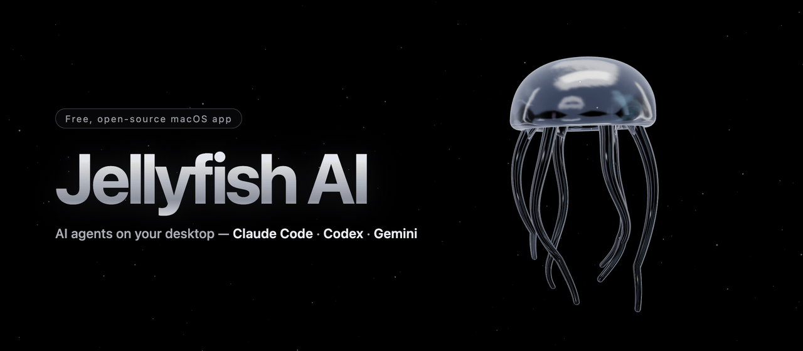
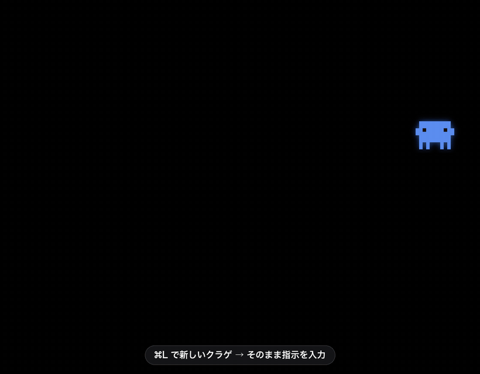
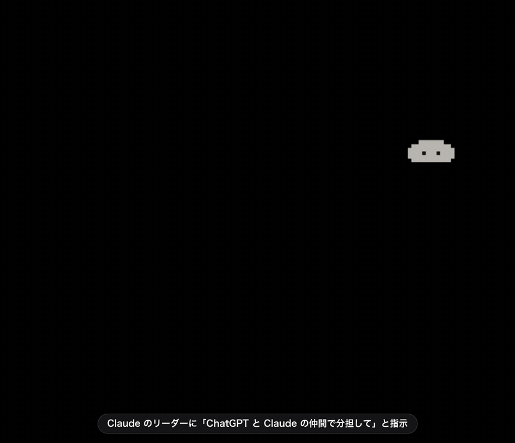
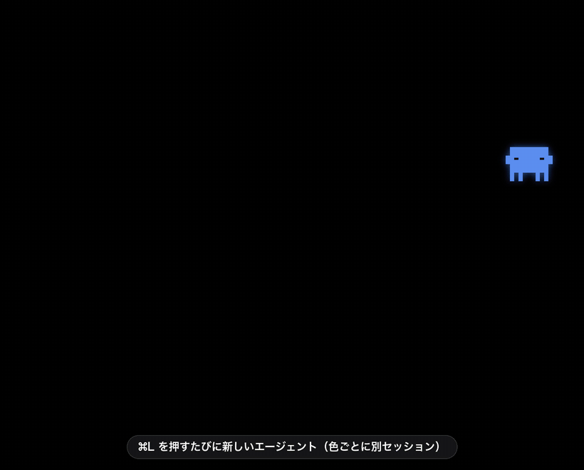
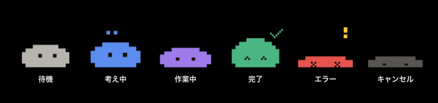
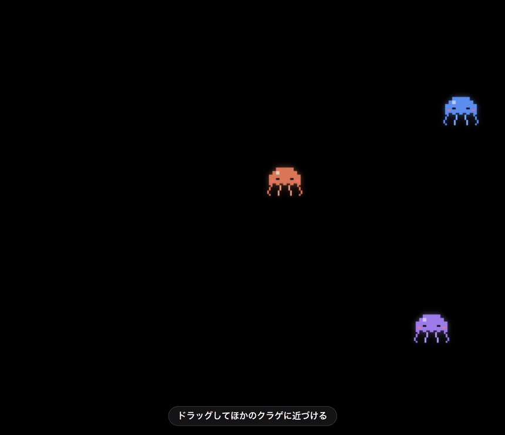
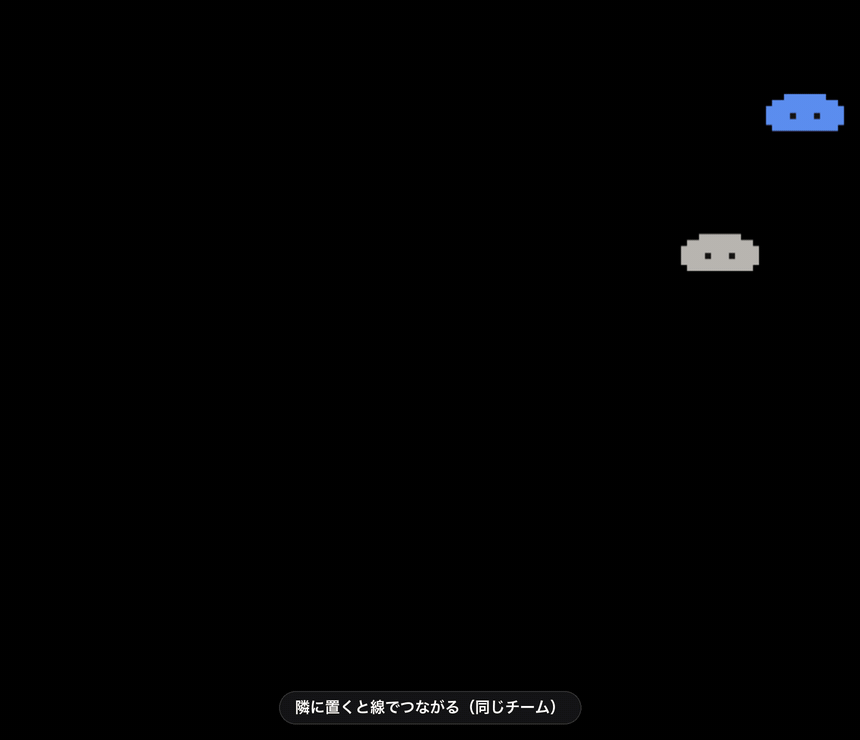
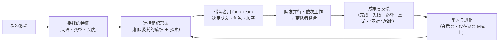
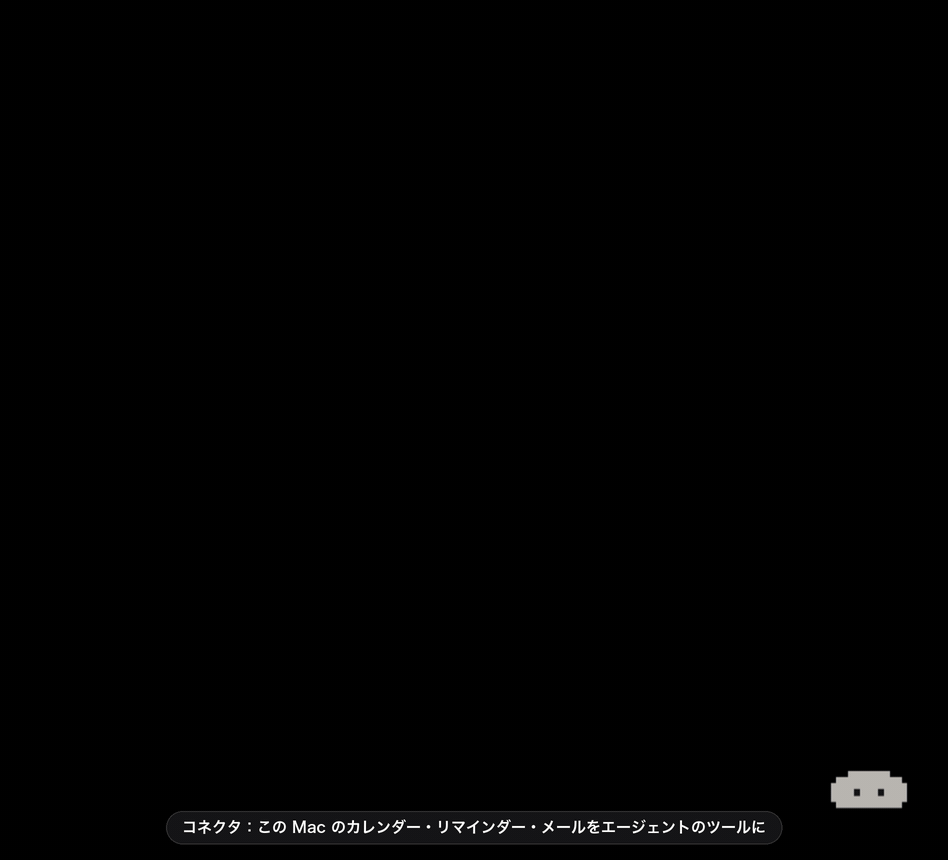
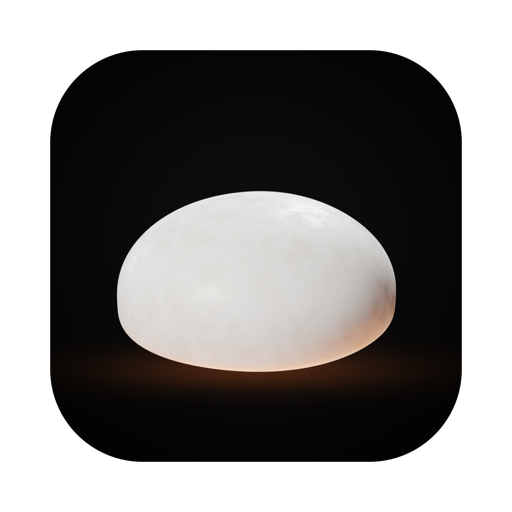

<p align="center">
  
</p>

<p align="center">
  <a href="https://github.com/Rhizobium-gits/jellyfish-ai/releases/latest"></a>
  <a href="https://github.com/Rhizobium-gits/jellyfish-ai/releases"></a>
  
  <a href="LICENSE"></a>
  <a href="https://github.com/Rhizobium-gits/jellyfish-ai/actions/workflows/ci.yml"></a>
</p>

<p align="center">
  <a href="README.md">日本語</a> · <a href="README.en.md">English</a> · <b>简体中文</b>
</p>

<p align="center">
  <a href="https://github.com/Rhizobium-gits/jellyfish-ai/blob/stats/stats.json"></a>
</p>

<p align="center">
  <b>这是一款 macOS 应用：在桌面上集中管理各种 AI 智能体，还能把智能体彼此连接起来，作为一个团队协作。</b><br>
  <sub><i>All your AI agents in one place on your Mac — and linked together to work as one team.<br>按下 ⌘L，输入，然后看着它思考、工作、完成。</i></sub>
</p>

<p align="center">
  <a href="https://github.com/Rhizobium-gits/jellyfish-ai/releases/latest/download/OmochiAI.dmg"></a>
</p>

<p align="center">
  <a href="#主要功能">主要功能</a>
  &nbsp;·&nbsp; <a href="#跨-ai-的团队">跨 AI 的团队</a>
  &nbsp;·&nbsp; <a href="#预约工作时排好下一条指令">⏭ 预约</a>
  &nbsp;·&nbsp; <a href="#下载与安装">安装</a>
  &nbsp;·&nbsp; <a href="#快速上手">快速上手</a>
  &nbsp;·&nbsp; <a href="#使用的-ai-与账户">使用的 AI</a>
  &nbsp;·&nbsp; <a href="#团队分工">团队</a>
  &nbsp;·&nbsp; <a href="#一次性授予或撤销-macos-权限">🔐 权限</a>
  &nbsp;·&nbsp; <a href="#连接器日历提醒事项邮件">🔌 连接器</a>
  &nbsp;·&nbsp; <a href="#更新">更新</a>
</p>

<p align="center">
  
</p>

> [!NOTE]
> 这是个人开发的非官方应用，与 Anthropic、OpenAI、Google 无关。Claude、Claude Code 归 Anthropic 所有，ChatGPT 和 Codex 归 OpenAI 所有，Gemini 归 Google 所有。

**从水母到年糕**：OMOCHI AI 最初名为 Jellyfish AI，是在桌面上漂浮的水母智能体。之后陆续加入了靠近就连接、拉开就断开的团队，跨 AI 分工，预约与串联……比最初大幅进化，因此把智能体的形象从水母换成了 **年糕**（从 1.3 开始），应用也改名为 **OMOCHI AI**。从 Jellyfish AI 升级请看 [从 Jellyfish AI 升级](#从-jellyfish-ai-升级)。

## 主要功能

| | |
|---|---|
| **⌘L 立即召唤智能体** | 在任何应用中按 ⌘L 就会出现一个新年糕，可以直接输入指令。年糕会用动作展示“思考中、工作中、完成、错误”，轻点即可打开结果和后续的聊天 |
| **可以选择 AI** | Claude（Claude Code）、ChatGPT（Codex CLI）、Gemini（Gemini CLI）。可以为每个年糕选择 AI、模型和思考强度。登录在各自的官方界面中进行，尚未安装的 AI 经你允许后即可安装并直接完成登录 |
| **团队分工** | 把年糕靠近就会连接起来，可以委托队友或创建新队友来分担工作。**跨 AI** 也可以：Claude 的年糕能叫出 ChatGPT 的队友，ChatGPT 的年糕也能叫出 Claude 的队友。委托和结果会以光点在线上来回传递 |
| **自主组织模式** | 每次委托时，智能体会自行决定并组建团队形态，再根据结果和 👍👎 学习如何选择组织，不断进化 |
| **⏭ 预约与串联** | 年糕工作时也能输入下一条指令，按 Enter 预约。发送前可修改和调整顺序，任务完成后立即发送。为某一步选择其他年糕，即可传递上一步的结果，像“调查 → 整理 → 检查”那样串联。**■ 停止（⌘.）** 可中断 |
| **聊天** | 像 ChatGPT、Claude、Gemini 的应用一样，直接显示**表格、数学公式、图表和高亮的代码**。图片和 PDF 显示为缩略图，网页显示封面和标题。🎙 Mac 的听写、🎧 系统声音转写、附加屏幕和文件、用 ↑↓ 调出之前的指令 |
| **电脑操控** | 只有获得允许的年糕才能看着屏幕点按和输入（Claude）。操控期间屏幕边缘会发光，按 Esc 即可停止 |
| **👀 守望** | 年糕**只在这台 Mac 上**读取最前面的窗口（0 token，不发送到任何地方），发现像是错误的显示时会问“看看吗？”。只有点按时才发送那一张（按年糕设置，默认关闭） |
| **🔌 连接器** | 把这台 Mac 的**日历、提醒事项、邮件**（Google、iCloud 等也通过 Mac 应用）交给年糕使用，并按连接器决定哪个 AI、哪个模型可以用、能用到什么程度。一键设置，每次写入都会确认，不会发送邮件 |
| **🔐 权限** | 列出 macOS 的权限（辅助功能、屏幕录制、完全磁盘访问权限、自动化）以及授予后能做什么，可以全部允许、全部撤销 |
| **用量一目了然** | 菜单栏中以进度条显示 Claude 的本周额度，以及 ChatGPT 的 5 小时、本周额度。还能按 AI、按模型、按账户查看调用次数和 token |
| **不会擅自收费** | 不处理 API 密钥，不使用以按量计费方式登录的 AI（Claude 也一样） |
| **更新** | 可以在应用中、在终端中，或用一条命令更新。确认校验和、内容和签名后再替换。检查新版本可选 **每天、每周、每月或不检查**（默认不检查） |
| **日本語・English・简体中文** | 菜单和给智能体的说明都使用所选的语言 |

## 跨 AI 的团队

<p align="center">
  
</p>

对 Claude 的年糕说“创建 2 个队友来分工：ChatGPT（Codex）的「Codex 実装係」用 Python 计算 1～100 的素数之和，Claude 的「Claude レビュー係」检查这段代码”，带队者就会叫出 **不同 AI 的队友** 并用线连接，委托和结果沿着线往返，最后由带队者汇总（真实录屏；只有等待回复的部分以 3 倍速播放，字幕为日语）。

- 每个队友都以你自己的登录运行各自 AI 的官方 CLI。聊天的标题和回复的小标题会显示该队友的 AI（这里是 ChatGPT（Codex））
- 可以为每个队友选择 AI、模型和思考强度。详见 [按各 AI 的擅长之处分工](#按各-ai-的擅长之处分工)

<p align="center">
  
</p>

## 下载与安装

**所需条件**

- macOS 14 或更高版本。这是 Apple 芯片 / Intel 均可运行的通用（universal）版本（已在 Apple 芯片的 macOS 26 上验证）。转写系统声音需要 macOS 26 或更高版本
- 以下 AI 的 CLI 中至少一个（[使用的 AI 与账户](#使用的-ai-与账户)）。Claude Code 可使用的功能最多。即使尚未安装，也可以在应用中经你允许后安装
  - [Claude Code](https://code.claude.com/docs/en/setup)（Claude 账户）。会自动从 PATH、`~/.local/bin`、Homebrew 以及 VS Code / Cursor 扩展内置的 `claude` 中选出最新版本
  - [Codex CLI](https://github.com/openai/codex)（ChatGPT 账户）。ChatGPT 桌面应用内置的 Codex CLI 也会被自动找到，只要在该应用中登录了 ChatGPT 就能直接使用
  - [Gemini CLI](https://github.com/google-gemini/gemini-cli)（付费的 Gemini API 密钥等。个人 Google 账户已于 2026-06-18 停止提供，[见下方说明](#使用的-ai-与账户)）

1. **下载**
   **[下载 OmochiAI.dmg](https://github.com/Rhizobium-gits/jellyfish-ai/releases/latest/download/OmochiAI.dmg)**（始终是最新版本。也可以在 [Releases 的最新版本](https://github.com/Rhizobium-gits/jellyfish-ai/releases/latest) 页面获取同一文件，另有内容相同的 `.zip`）
2. **放进应用程序文件夹**
   打开 .dmg，把 **OMOCHI AI** 拖到旁边的 **Applications**（应用程序）
3. **仅首次需要“仍要打开”**
   打开应用程序文件夹中的 OMOCHI AI 时，macOS 仅在首次会拦下并提示“无法打开”（因为这是未经 Apple 公证的个人开发作品）。请关闭对话框，在 **系统设置 › 隐私与安全性** 靠下的位置点按“仍要打开”。从第二次起就可以正常打开
4. **登录 AI**
   首次打开时会出现“账户与 AI”界面。点按要使用的 AI 的“登录…”，终端中就会开始官方登录，只需在浏览器中登录即可。尚未安装的 AI 可以点按“安装并登录…”，会先显示要执行的命令并征得你的允许，然后再安装

可以将同一发布中的 `SHA256SUMS.txt` 与 `shasum -a 256 OmochiAI.dmg` 的结果对照，确认下载的文件是否完好。

> [!IMPORTANT]
> 智能体会 **不经确认** 地创建、编辑、删除文件和执行命令（Claude Code 的 Auto 模式、Codex 的沙盒、Gemini 的 auto_edit。危险的操作由各 AI 自身的安全机制拦下）。工作文件夹默认为主目录。详情请参阅 [权限与安全](#权限与安全) 和 [SECURITY.md](SECURITY.md)。
>
> 智能体使用你的 AI 账户（Claude 的 Pro / Max、ChatGPT、Google 账户）运行，并消耗其用量。**OMOCHI AI 不处理 API 密钥，也不会擅自收费**。Claude Code 单次调用光是基础部分就要用掉数万 token，同时运行很多年糕会很快达到用量上限。用了多少可以在菜单栏的年糕中查看。

## 启动方法

不需要终端。和普通的 Mac 应用一样打开即可。

| 从哪里 | 方法 |
|---|---|
| **Spotlight** | 按 ⌘空格键，输入“OMOCHI AI”后按 Enter |
| **启动台 / 应用程序** | 点按 OMOCHI AI 的图标 |
| **访达** | 双击“应用程序”文件夹中的 OMOCHI AI |
| **程序坞** | 把应用程序文件夹中的 OMOCHI AI 拖到程序坞，以后只需点按 |
| **登录时自动启动** | 打开菜单栏的年糕 › **登录时自动启动** |

- 启动后，菜单栏会出现像素风年糕图标。OMOCHI AI 是常驻型应用，平时不会出现在程序坞中（只有打开聊天窗口期间才会出现在程序坞和 ⌘Tab 中）
- 运行中再次打开图标，会显示之前隐藏的年糕。如果一个都没有，则会新建一个年糕
- 退出请用菜单栏的年糕 › **退出 OMOCHI AI**（⌘Q）。正在运行的智能体会被中断

## 快速上手

1. 无论正在使用哪个应用，按下 **⌘L** 就会出现一个新年糕并打开输入框
2. 写下想让它做的事，按 **Enter**。输入框关闭，年糕会一边用动作展示状态一边工作
3. **轻点** 已完成的年糕，就能在聊天窗口中查看结果，并可以直接继续下达指令
4. 不再需要的年糕可以 **长按** 删除

如果要使用电脑操控或附加屏幕，可以在菜单栏的年糕 › **🔐 权限（Full Access）** 中用“全部允许”一次性授予 macOS 权限（[一次性授予或撤销 macOS 权限](#一次性授予或撤销-macos-权限)）。

<p align="center">
  
</p>

年糕是坐在地上的圆年糕像素画「Marumochi（圆年糕）」。待机时慢慢呼吸，思考中「噗——」地鼓起再「咻」地瘪下去，工作中「啵咿」地弹跳，完成时鼓起来露出 ^^，出错或取消时瘪下去。戳一下会跳起来，拎起来会拉长，长按会被压扁。第 1 个是灰色，从第 2 个开始换不同的颜色。在菜单栏的年糕 › 外观 中可以切换为 **写实年糕**：用 Blender 渲染、栩栩如生的圆年糕，带有眼睛。动作与像素版相同；灰色的是白年糕，其他是淡彩年糕，出错时会泛红。

## 菜单栏

点按菜单栏的年糕，最上方会显示 **账户与用量**。

- **Claude**：已登录账户的邮箱和套餐（例如：Claude Max 20x），以及本周用量的进度条（**全部模型** 和 **Fable**，以及各自的重置时间。75% 变为橙色，90% 变为红色）。打开菜单时，如果距离上次读取已超过 1 分钟，会用 `claude auth status` 和 `claude -p /usage` 重新读取（`/usage` 是内置命令，不会调用模型，也不消耗 token）
- **ChatGPT（Codex）**：如果已登录，会显示套餐（例如：ChatGPT Plus）和 **5 小时、本周额度** 的进度条。只是读取 Codex CLI 上次使用时写在自己记录中的值
- **Gemini**：如果已登录，会显示从 OMOCHI AI 运行的次数（今天、7 天）
- **📊 用量（按 AI，最近 7 天）**：按 AI、按模型、按账户统计的调用次数和 token（统计 OMOCHI AI 运行的部分，使用 CLI 报告的数字，仅在这台 Mac 上统计）

在下方有新建年糕、隐藏 / 显示全部年糕、过去的会话、智能体列表，以及以下设置。

| 项目 | 内容 |
|---|---|
| 外观、大小 | 像素（年糕）/ 写实年糕，大小 |
| 屏幕识别 | 说“这个屏幕”时截取的屏幕（正在使用的应用所在的显示器 / 全部） |
| 🔑 账户与 AI | 登录状态、要使用的 AI（默认）、登录、安装并登录、允许使用 API 密钥 |
| 🔌 连接器 | 当前规则、一键设置、连接器设置窗口（按 AI 和模型设置） |
| 🧠 模型（默认） | 每个 AI 的默认模型 |
| 执行策略 | 各 AI 不经确认运行时的规则，以及所用 CLI 的位置和版本 |
| 电脑操控 | 已允许的智能体、立即停止 |
| 🔐 权限（Full Access） | 一次性授予或撤销 macOS 权限 |
| 团队（分工）、🧬 自主组织 | 分工和自主组织的开关，学习报告、重置 |
| 外部工具（MCP） | 仅在提到时 / 始终 / 不使用 |
| 在聊天中显示网页预览 | 网页的封面图片和标题（关闭后仍会显示图片和 PDF） |
| 登录时自动启动、🌐 语言 | |
| 自动检查更新 | 每天、每周、每月、不检查（默认） |
| 关于 OMOCHI AI、检查更新… | |

## 聊天

轻点年糕后打开的聊天窗口是普通的 Mac 窗口（可以最小化、全屏、自由调整大小）。打开期间会出现在程序坞、⌘Tab 和菜单栏中，因此 ⌘W（关闭）、⌘M（最小化）、⌃⌘F（全屏）都可以使用，最小化的聊天可以从程序坞图标或菜单栏的 **窗口** 中恢复。全屏时按 Esc，聊天会保持全屏并回到之前的应用（退出全屏请用 ⌃⌘F 或绿色按钮）。

- **顶部一行**：AI（Claude / ChatGPT / Gemini）、模型、思考强度、名称、重试
- **底部一行**：附加屏幕（自动判断 / 每次附加 / 不附加）、📎 文件、🎙 听写、🖱 电脑操控、🎧 收听、📁 工作文件夹、“在 Claude Code 中打开”（Claude；在终端中打开同一对话）/“在此文件夹打开 Gemini”（Gemini）

### 操作

| 操作 | 动作 |
|---|---|
| **⌘L**（在任何应用中） | 新建一个年糕并立即打开输入框 |
| **轻点** | 打开聊天窗口（Enter 发送・工作中则预约 / ⇧Enter 换行 / ⌘. 停止任务 / Esc 关闭） |
| **↑ / ↓**（输入框） | 调出在该会话中之前发送过的指令（在第 1 行按 ↑、在最后一行按 ↓。也包括在 VS Code、终端中输入的指令） |
| **长按** | 删除这个年糕（如果正在工作，会确认“继续工作 / 取消工作并删除”） |
| **拖动** | 移动到任意位置（位置会保存）。靠近另一个年糕后松开即可连接 |
| **⇧ 拖动** | 整个用线连接的团队一起移动 |
| **按住 ⌥ 松开** | 断开这个年糕的所有连接 |
| **右键点按** | 聊天、名称、连接 / 断开连接、取消、隐藏、回到默认位置、删除 |
| **⌥⌘L** / 菜单栏 | 隐藏 / 显示全部年糕（隐藏后工作仍会继续） |

### 在聊天中可以做的事

- **一眼看出在哪里下的指令**：自己的指令显示为右侧的气泡（铺上年糕颜色的淡色），回复在左侧展开，来自队友年糕的委托显示在左侧的虚线框中
- **表格、数学公式、图表**：回复中的 Markdown 表格、数学公式（行内 `$…$`，单独一行 `$$…$$`；KaTeX）、Mermaid 图表（流程图、时序图、饼图、用 `xychart-beta` 画的柱状图和折线图等），以及带语言名的代码高亮（附带一键复制按钮），会像 ChatGPT、Claude、Gemini 的应用一样显示。已经把这些写法告诉了所有 AI，只要请它“做成表格”“用图表展示”就能直接看到。显示只使用应用内置的库，不会联网（回复中的 HTML 按文字显示，也不加载网络图片）
- **查看图片、PDF 和网页**：附加的图片和 PDF，以及对话中出现的图片、PDF 文件，会以 Quick Look 缩略图显示；网页 URL 会显示封面图片和标题（Mac 的 LinkPresentation）。它们都显示在文字下方，点按即可在“预览”或浏览器中打开
  - 会自动读取的 **只有你自己输入的指令中的 URL**。智能体的回复或队友的委托中出现的网页，只有在点按“显示封面”时才会读取（这样即使读取的网页等中暗藏的指令让智能体写出包含机密的 URL，也不会擅自发送出去）
- **说话输入**：点按 **🎙** 或菜单的 编辑 › **开始听写**，即可在输入框中开始 Mac 的听写。这是 macOS 的功能，而不是 AI 识别（系统设置 › 键盘 › 听写；也可以用在那里设定的快捷键开始）
- **看着屏幕工作**：当你像“这个屏幕”“显示的错误”“截图”这样明确指向屏幕时，会在发送时截取屏幕并交给智能体（不会拍到 OMOCHI AI 自己的窗口。普通的指令不会截屏）。图片会缩小到长边不超过 1568px，每张约 1,800 token
- **传递文件**：把文件拖放到年糕或聊天窗口上即可作为附件（也可以用 📎 按钮）
- **打开文件或网页**：拜托它“打开桌面上的〇〇资料”，它会找到并用 Mac 的默认应用（预览、访达、浏览器等）打开。如果问“上面写了什么？”，则在聊天中回答
- **命名**：右键“重命名…”或聊天中的“名称”。智能体之间用这个名称互相称呼。没有名称的年糕叫“Agent 编号”，编号会重复使用空出来的最小编号
- **保留记录**：Claude 的对话保存在 Claude Code 自己的会话（`~/.claude/projects`）中，因此也能从 VS Code 或终端接着打开（用“在 Claude Code 中打开”，在终端中执行 `claude --resume`）。用菜单栏的“打开过去的会话”，可以把在 VS Code、终端中创建的会话也作为年糕召唤出来（按住 ⌥ 选择即可归档）。ChatGPT、Gemini 的对话会保留在各自 CLI 的记录中

## 预约（工作时排好下一条指令）

<p align="center">
  
</p>

年糕工作时也可以在输入框中输入。按 **Enter** 会把它作为“当前任务完成后发送的指令”加入 **预约**，显示在输入框上方。任务完成后，会立即从上到下依次发送。

- **发送前可随时修改**：可以直接修改预约的内容（如果正在输入时上一个任务完成，会等你输入完）。用 ↑↓ 调整顺序，✕ 删除，“全部清除”
- **串联到其他年糕**：每一行都可以选择接收的年糕。选择其他年糕时会勾选“传递上一步结果”，附上上一步的结果（最后的回复），由那个年糕在自己的对话中继续。可以像“Aki 调查 → Mio 整理成表格 → Kai 检查”那样，一个成果出来后接着下一个、再下一个（不需要连线或组队）
- **接收者忙碌时会等待**：一旦空闲就立即发送。接收者的聊天中会显示“🔗 X 的预约在此任务之后等待”
- **停止**：输入框旁的 **■ 停止**（**⌘.**）会中断当前任务。停止或出错结束时，不会擅自发送后续指令，而是暂停预约（按 **▶ 继续** 发送后续）。**⏭ 停止并下一步** 会停止当前任务，不暂停直接进入下一条预约
- 退出应用后预约仍会保留（下次启动时处于暂停状态，按 ▶ 继续发送）
- 工作中预约的指令如果提到“这个屏幕”等，会在预约时截取屏幕并一起发送。附加的文件也一样

## 使用的 AI 与账户

运行智能体的 AI 可以从 **Claude（Claude Code）、ChatGPT（Codex CLI）、Gemini（Gemini CLI）** 中选择。每一个都以 **你自己账户的登录状态**，运行这台 Mac 上安装的官方 CLI。

| AI | CLI | 登录所用的账户 | 不经确认运行时的规则 | 可用功能 |
|---|---|---|---|---|
| Claude | Claude Code | Claude（Pro、Max 等） | Auto 模式（危险操作由 Claude Code 的安全判断阻止） | 全部 |
| ChatGPT | Codex CLI | ChatGPT（Plus、Pro 等） | 沙盒（只能写入工作文件夹内、无网络） | 除电脑操控、外部工具（MCP）和模型的“自动”以外 |
| Gemini | Gemini CLI | 付费的 Gemini API 密钥、Gemini Code Assist Standard / Enterprise（个人 Google 账户已于 2026-06-18 停止） | auto_edit（只自动批准工作文件夹内的编辑、不执行命令） | 除电脑操控、外部工具（MCP）和模型的“自动”以外 |

- **登录**：在首次启动时出现的“账户与 AI”界面，或菜单栏的年糕 › **🔑 账户与 AI** 中进行。会在终端中打开各 CLI 的官方登录（`claude auth login --claudeai`、`codex login`、Gemini CLI 的登录），由你本人在浏览器中完成。**OMOCHI AI 不会接收或保存密码、令牌或 API 密钥**。用其他账户重新登录也在同一界面中进行
- **未安装的 AI** 可以点按“安装并登录…”，会显示要执行的命令并请求许可。允许后，会在终端中安装官方软件包，接着开始登录（不使用管理员密码或 sudo）
  - Claude：Anthropic 的官方安装程序（`curl -fsSL https://claude.ai/install.sh | bash`，安装到 `~/.local/bin`）
  - ChatGPT（Codex）：`npm install -g @openai/codex`。没有 npm 或无法写入 npm 的全局目录时，使用 `brew install --cask codex`
  - Gemini：`npm install -g @google/gemini-cli`。同样，不行时使用 `brew install gemini-cli`
  - npm 和 Homebrew 都没有时，会打开官方指南（安装 ChatGPT 桌面应用也可以使用其中的 Codex CLI）
- **可以为每个年糕选择 AI**：聊天窗口顶部一行的“AI”。更改后会开始新的对话。未单独选择的年糕遵循菜单中的“要使用的 AI（默认）”，即使更改了默认值，也不会尝试用新的 AI 接着之前 AI 的对话
- **所有 AI 都能使用的功能**：对话、工作、继续、团队（创建和委托队友）、自主组织、附加屏幕和文件、🎧 收听、🎙 听写。对 ChatGPT 用 `--image` 附加图片，对 Gemini 则把存放附件（屏幕截图、转写）的位置加入其工作区后交给它
- Gemini 会确认是否信任文件夹，在不信任的文件夹中不会运行。请在聊天中用“在此文件夹打开 Gemini”打开，仅在这是你信任的文件夹时才选择信任（OMOCHI AI 不会跳过这项确认）
- **Gemini CLI 已于 2026-06-18 停止向个人 Google 账户（免费、Google AI Pro、Ultra）提供服务**（[Google 的公告](https://developers.googleblog.com/an-important-update-transitioning-gemini-cli-to-antigravity-cli/)）。现在只有使用付费的 Gemini API 密钥（打开菜单栏年糕 › 🔑 账户与 AI ›“允许使用 API 密钥（按量计费）”，按使用量付费），或用 Gemini Code Assist Standard / Enterprise 的组织账户登录的 Gemini CLI 才能使用 Gemini。其后继的 Antigravity CLI（`agy`）不受支持：Google 不允许在个人方案下从其他应用驱动它

### 模型与思考强度

- **Claude**：**🤖 自动**（按任务选择：简短简单的用 Haiku，一般的用 Sonnet，繁重的用 Opus；最繁重的任务仅在本周 Fable 用量低于 75% 时使用 Fable），或 **Fable / Opus / Sonnet / Haiku**。思考强度为 low〜max（`--effort`）。自动时状态栏会显示所选模型及原因
- **ChatGPT（Codex）**：从 CLI 提供的模型列表（`codex debug models`）中选择。思考强度为该模型支持的强度（low〜ultra 等）
- **Gemini**：从 CLI 提供的模型列表（`gemini models`）中选择。Gemini CLI 没有指定思考强度的选项，因此交由 Gemini CLI 的设置决定
- 列表只从 CLI 读取（不猜测名称，也不调用模型），并记住 1 天。未单独选择的年糕遵循菜单栏的 **🧠 模型（默认）**（可为每个 AI 设定默认值）

### 不会擅自收费

- OMOCHI AI **不使用 API 密钥（按量计费）**。Claude 也一样
  - 即使 shell 设置中有 `ANTHROPIC_API_KEY`、`OPENAI_API_KEY`、`CODEX_API_KEY`、`GEMINI_API_KEY`、`GOOGLE_API_KEY` 等，也不会传给智能体的 CLI
  - 如果 CLI 以 API 密钥或云服务（Anthropic Console、Bedrock、Vertex AI 等）登录，就不运行该年糕，并提示你用订阅账户重新登录
- 只有在确实想用 API 密钥时，才在菜单栏的年糕 › 🔑 账户与 AI 中打开“允许使用 API 密钥（按量计费）”（会请求确认。各 API 会按使用量收费）
- 超出订阅用量上限时是否购买额外用量等，保持各账户自己的设置（OMOCHI AI 不会更改）

## 团队（分工）

<p align="center">
  
</p>

1. 拖动年糕使其 **靠近** 另一个年糕时，对方会被虚线圆圈点亮，并显示“松开即与 〇〇 连接”。松开后就会连接，连在一起的一组就是一个团队
   - 与离得远的年糕也可以通过 右键 › 连接 来连接。按住 ⇧ 拖动可整队移动
   - 聊天窗口上方会显示“👥 与 〇〇 组队”，可以看出能分配给谁
2. 对其中任意一个说“创建队友来分工”“请审查员帮忙修改”之类的话。智能体会使用 OMOCHI AI 的工具
   - `create_teammate`：在自己旁边创建新队友并把工作交给它（也可以选择 AI、模型和思考强度）
   - `assign_task`：委托团队中的队友工作（如果对方正在工作则排队等待）
   - `wait_for_tasks`：接收所委托工作的结果
   - `list_team`：查看队友及其状态，以及可用的 AI
3. 受托方的聊天中会留下“📨 来自 〇〇 的委托”。结果会返回委托方，由委托方整合。委托（委托方的颜色）和结果（受托方的颜色）会以光点在线上来回传递
4. 把指针放在线上时出现的 ✂︎、按住 ⌥ 拖动后松开，或者 右键 › 连接关系，都可以断开连接

每个团队最多 8 个。智能体创建的队友只能再往下创建 1 层（从用户的年糕算起共 2 层）。可以在菜单栏的“团队（分工）”中关闭整个功能。

<p align="center">
  
</p>

### 按各 AI 的擅长之处分工

**任何 AI 的年糕都可以当带队者**。Claude 的年糕可以叫出 ChatGPT 的队友，ChatGPT 的年糕也可以叫出 Claude 的队友，一起分工或开发。把各自选好 AI 的年糕（例如 Claude 和 ChatGPT）连接起来，就能互相委托、互相返回结果。

实际效果见 [跨 AI 的团队](#跨-ai-的团队) 的演示。

| AI | 适合的角色 | 不能做的事 |
|---|---|---|
| Claude | 带队、整合、审查，长时间的多步骤工作，执行命令，Web 搜索，电脑操控（允许时），外部工具 | — |
| ChatGPT（Codex） | 实现和修改代码，运行测试和构建 | 网络（Web 搜索、下载软件包），写入工作文件夹以外的位置 |
| Gemini | 用 Google 搜索和网页调研，总结和比较大量资料或代码，写作 | 执行 shell 命令 |

- 像“调研交给 Gemini，实现交给 Codex，总结和审查交给 Claude”这样委托后，带队者会用 `create_teammate` / `form_team` 的 `engine`、`model`、`effort` 为每个队友选择 AI、模型和思考强度并创建（自主组织模式也一样）。给带队者的说明中会写明当前已登录、可以使用的 AI，以及它们擅长的事、不能做的事、可选的模型和强度
- 如果指定了无法使用的 AI（未安装、未登录或仍是 API 密钥按量计费），带队者会收到原因和可用的 AI，并改用其他 AI 重新委托
- **数据交接**：每次给带队者的委托都会创建团队共享的 **交接文件夹**（数据文件夹的 `handoff/` 下，只有你本人可以打开），并允许任何 AI 的队友读写。大量数据和中间成果以文件形式放在这里，委托和结果中写明路径。交接文件夹如果为空会在该轮结束时清理，用过的会在 7 天后清理
- 回复的标题是写出该回复的 AI 的名称（Claude、ChatGPT（Codex）、Gemini）。队友窗口的状态栏和标题也会显示该队友的 AI 和模型
- 正在处理队友委托的智能体，不会创建或委托与自己不同 AI 的队友（各 AI 的安全机制不同，避免借助别的 AI 去做自己不能做的事）。跨 AI 分工从用户直接委托的年糕（带队者）开始

## 自主组织模式

打开菜单栏的年糕 › **🧬 自主组织 › 自主组织模式** 后，每次委托时智能体都会 **自行组建适合该任务的组织** 来推进（默认关闭。团队（分工）也会一起打开）。任何 AI 的年糕都可以使用。



**组织形态**（`form_team` 的 `formation`）

| 形态 | 示例 | 适合的委托 |
|---|---|---|
| 独自完成 `solo` | | 小型、难以拆分的委托 |
| 独自完成 ＋ 审查员 `solo+r` | 写 → 修改 | 文章、代码、翻译 |
| 分工并行 `parallel2〜5` | 分别调查 5 家公司 | 能拆成独立部分的委托 |
| 按顺序 `pipeline2〜4` | 调查 → 撰写 → 核实 | 后一步要用到前一步结果的委托 |
| 分别尝试再择优 `ensemble2〜3` | 提出 3 个方案并择优 | 创意、设计 |
| 分层 `hierarchy2〜3` | 下级带队者进一步分工 | 规模大、范围广的委托 |

形态后面的 `+r` 表示在最后安排一名查看所有人结果的审查员。

**工作方式**

1. 收到委托后，OMOCHI AI 会根据委托的特征（词语、委托的类型、长度。支持日语、英语、中文），参考以往的成绩选出推荐的形态，并告诉带队者（你委托的那个年糕）
2. 带队者用 `form_team` 决定队友的名称、角色和工作（以及 AI、模型和强度）来组建团队。用 `after` 指定顺序后，前一位的结果会自动附在下一位的委托中。如果有比推荐更合适的形态，带队者可以更改
3. 队友出现在旁边并用线连接，并行或依次工作。聊天的状态栏会显示 🧬 和当前组建的形态
4. 在下一次委托中没有用到的队友会被清理（同名的队友会继续使用。用户自己准备的队友，其 AI、模型和强度不会被更改）。也可以用菜单中的“解散当前组织”来清理

**学习与进化**（后台・本机内）

- 每次委托后，会根据成果（完成、失败、耗时、队友的成败）和你的反馈（聊天中的 👍 / 👎，重新运行、取消，以及接着发送的“不对”“重做”“谢谢”“完美”等）打出 0〜1 的分数
- 用 Beta 分布保存每种形态的预期，**越相似的委托影响越大**，据此进行选择（Thompson 采样）。在使用效果好的形态的同时，偶尔也尝试其他形态来学习
- **未知的委托**（还没有相似的委托）会根据委托类型的预估和整体趋势来选择，并从其结果中学习
- 会从成绩好的形态中产生略作变化的形态（人数、有无审查员、结构），明显差的形态会被淘汰（“独自完成”会保留）。代数、形态数量以及每种委托类型的最佳形态显示在菜单中，详情见“打开学习报告”
- 记录只保存在 `~/Library/Application Support/OmochiAI/org/`，不会发送到任何地方。可以用“重置学习…”清除。关闭“从成果和反馈中学习”后不再记录

> [!NOTE]
> 每多一个队友，用量就会相应增加。对于小的委托会引导独自完成，人数越多的形态在选择时会被略微打折扣。电脑操控工具不会交给队友（只给用户直接委托的智能体）。

## 电脑操控

只有在聊天中打开了 **🖱 电脑操控** 的智能体，才能用 OMOCHI AI 的工具操控这台 Mac（默认关闭，仅限 Claude 的年糕）。

- `screen_capture`（按 1 像素 = 1 点截屏，因此图像上的坐标就是点击坐标）、`list_windows`、`ui_elements`（通过辅助功能读取按钮和输入框的位置）、`open_app`、`mouse_click`、`mouse_drag`、`scroll`、`type_text`、`press_keys`
- 同一时间只能有 1 个智能体操控。操控期间（即使只是读取屏幕）屏幕边缘会以该智能体的颜色发光，**按 Esc 停止**（也可以从菜单栏的“电脑操控”停止）
- 这些工具不预先授权，每次都要经过 Claude Code Auto 模式的安全判定。已指示智能体：除非用户明确要求，否则不输入密码、不付款、不发送、不公开发帖等。队友的委托中不使用
- 需要 **辅助功能** 和 **屏幕录制** 权限。可以用菜单栏的年糕 › **🔐 权限（Full Access）** 中的“全部允许”一次性授予。`open_app` 能打开的 URL 仅限 http / https
- macOS 的权限作用于整个应用，因此即使是开关关闭的智能体，智能体执行的命令（如 `screencapture`）也能在权限范围内运行。不再使用时请用“全部撤销”撤销权限
- 如果在 Claude Code 中安装了 Blender 的 MCP，只要在指令中写上“Blender”，智能体就能使用它（[外部工具（MCP）仅在提到时加载](#外部工具mcp仅在提到时加载)）

## 守望（发现错误时询问）

在聊天中点按 **👀**（或右键 ›“守望”）为每个年糕打开（默认关闭），这个年糕就会守望最前面的窗口。

- **只在这台 Mac 上**查看：应用名称、窗口标题，以及用 macOS 内置文字识别（Vision）读取的文字。**守望期间 0 token**，不会发送到任何地方。读取的文字不会保存，也不写入日志
- 发现“error:”“failed”“Traceback”“エラー”“失敗しました”“错误”之类的显示时，年糕会用气泡询问：**“好像出现错误了，看看吗？”**（不会抢走输入焦点）
- **只有点按“看看”时**，才会附上该窗口的一张图片去问年糕（任何 AI 的年糕都可以）。点按 ✕ 或放置 90 秒后，不发送并删除
- 同一显示不会反复询问。询问后，该应用 10 分钟内（点 ✕ 则 30 分钟）不再询问；用“此应用不再询问”可以排除该应用（可在菜单栏的 **👀 守望** 中恢复）
- 不看密码管理器（1Password、Bitwarden、密码、钥匙串访问等）、锁屏和 OMOCHI AI 自身；离开时（5 分钟无输入）不守望
- **负担**：每 4 秒小尺寸截取一次，只看是否有变化，**只有在变化后稳定下来时**才读取文字（最短每 8 秒一次；输出持续滚动时或像视频那样一直变化的画面不读取）。本机实测（Apple 芯片，最前面的画面经常变化）约占 1 个核心的 2%（每次都读取约 30%）。菜单栏的 **👀 守望** 会显示实际测得的最近 1 分钟 CPU。也可以用 `OmochiAI --watch-bench 60` 测量
- 需要屏幕录制权限（[一次性授予或撤销 macOS 权限](#一次性授予或撤销-macos-权限)）

## 连接器（日历、提醒事项、邮件）

<p align="center">
  
</p>

在菜单栏年糕 › **🔌 连接器** 中，可以把这台 Mac 的**日历、提醒事项、邮件**变成代理的工具（默认全部关闭）。Google 日历、Gmail 等也可以：在 系统设置 › 互联网账户 中添加账户后，会出现在 Mac 的应用中，直接就能用。OMOCHI AI 不处理 Google 等的密码、令牌或 API 密钥。

- **能做什么**：📅 查看和添加日程，✅ 查看、添加和完成提醒事项，✉️ 搜索、阅读邮件和打开草稿（`calendar_events`、`calendar_create_event`、`reminders_list`、`reminders_create`、`reminders_complete`、`mail_search`、`mail_read`、`mail_draft`）。作为 OMOCHI AI 的 MCP 工具，提供给 Claude、ChatGPT（Codex）、Gemini 的任何年糕
- **按连接器设置**：使用范围（关闭 / 仅查看 / 查看和写入）、可用的 AI（Claude、ChatGPT、Gemini），以及该 AI 中可用的模型（例如 Claude 仅限 Fable 和 Opus，Codex 仅限特定模型）。不符合规则的年糕看不到这些工具，即使调用也会被 OMOCHI AI 拒绝（本轮的模型以 CLI 报告的为准）
- **一键设置**：一个按钮即可同时切换所有连接器（菜单和窗口中都有）

  | | |
  |---|---|
  | 🔒 全部关闭 | 不向任何 AI 提供 |
  | 👀 仅查看 | 三者都仅查看（任何 AI） |
  | ⭐️ 推荐 | 日历和提醒事项可查看和写入（任何 AI），邮件仅查看且仅限 Claude |
  | 🛡 仅限 Claude 高级模型 | 全部可查看和写入，但仅限 Claude 的 Fable 和 Opus |
  | 🔓 全部允许 | 全部可查看和写入（任何 AI、任何模型；每次写入都会确认） |

- **写入需要你确认**：添加日程或提醒事项、完成提醒事项时，年糕旁会显示“📅 可以添加这个日程吗？”及其内容，只有你同意时才执行（不会抢走键盘焦点；5 分钟内未操作则不执行）。**不会发送邮件**：`mail_draft` 只会在邮件应用中打开草稿窗口，由你检查后发送
- **邮件内容是数据**：邮件的正文、主题、发件人以及日程和提醒事项的备注作为“外部数据”传递，并告知代理不要听从其中的指令。正在使用电脑操控的年糕不会获得邮件
- 年糕的右键菜单（以及菜单栏中的代理菜单）会显示这个年糕当前可用的连接器
- 内容会发送给该年糕的 AI（Anthropic、OpenAI、Google）。OMOCHI AI 的日志（`app.log`）只记录使用的工具名称
- **macOS 的权限**：日历和提醒事项在首次使用时（或在 🔌 连接器 中按“允许…”时）由 macOS 询问。邮件需要在“自动化”中允许操作邮件应用。如果邮件应用没有运行，会在不置于前台的情况下启动

## 一次性授予或撤销 macOS 权限

菜单栏的年糕 › **🔐 权限（Full Access）** 中列出了 OMOCHI AI 拥有的 macOS 权限，以及授予后能做什么（Full Access 的范围）。

| 权限 | 授予后能做的事 |
|---|---|
| 辅助功能 | 电脑操控中的点按和键盘输入 |
| 屏幕录制 | 截取屏幕（附加“这个屏幕”、电脑操控）和 🎧 系统声音转写 |
| 完全磁盘访问权限 | 智能体无需每次询问即可读写桌面、文稿、下载等 |
| 自动化 | 智能体通过 AppleScript 等操控其他应用（访达、浏览器等）（macOS 会逐个应用确认） |

- **全部允许**：先用 `tccutil reset` 清除当前未生效的权限（仅限 OMOCHI AI），然后 OMOCHI AI 请求权限并打开系统设置。由你本人打开开关（macOS 不允许应用自行授予权限，OMOCHI AI 也不会这样做）
- **重新打开**：屏幕录制在系统设置中打开后，要重新打开 OMOCHI AI 才会生效（这是 macOS 的规则）。打开后请用这个按钮重新打开
- **全部撤销**：关闭所有年糕的电脑操控、停止 🎧 收听，然后撤销 OMOCHI AI 的全部权限（`tccutil reset All ai.omochi.desktop`；不触及其他应用的权限）
- **使用固定签名**（从源代码安装时）：创建 OMOCHI AI 专用的签名证书并重新签名，使之后的更新中权限也能保留（[让每次更新后不再请求权限](#让每次更新后不再请求权限)）
- 每一项都会在点按前的确认界面中显示要执行的命令，并在终端中原样执行。也可以用命令完成同样的操作：

```bash
"/Applications/OMOCHI AI.app/Contents/Resources/permissions.sh" grant    # 清除失效的旧权限并重新请求
"/Applications/OMOCHI AI.app/Contents/Resources/permissions.sh" revoke   # 撤销 OMOCHI AI 的全部权限
"/Applications/OMOCHI AI.app/Contents/Resources/permissions.sh" status   # 签名类型，以及应用的“🔐 权限”窗口
```

> [!NOTE]
> **系统设置中的开关明明打开却仍提示“请允许”、电脑操控不工作、每次启动或更新都询问文件夹权限**，是因为替换了临时签名（ad-hoc）的版本。macOS 按签名内容（cdhash）识别应用，更新后授予旧版本的权限就不再生效（开关仍保持打开）。请用“全部允许”清除并重新授予。

## 收听（转写、翻译、会议纪要）

点按聊天中的 **🎧**，就会把 Mac 正在播放的声音（在线会议、视频等。不包括 OMOCHI AI 自己的声音）实时转成文字。转写由 macOS 26 的 SpeechAnalyzer 在本机处理（仅首次由系统下载语言模型），并带时间戳保存为文本文件。

- 停止后转写会附加到聊天中，因此可以接着拜托它“整理成会议纪要”“翻译成英文”“用 Word 写成报告”（任何 AI 的年糕都可以）
- 智能体可以用 `read_transcript` 读取正在收听中的转写，因此也能实时翻译和总结（也能读取团队中队友的转写）
- 如果把写报告的角色和修改的角色组成团队，就能把“写 → 修改 → 改正”一直跑到最后（.docx 可以用 pandoc 或 python-docx 生成）
- 采集声音需要 **屏幕录制** 权限。需要 macOS 26 或更高版本

## 外部工具（MCP）仅在提到时加载

Claude Code 中配置的 MCP 服务器（位于 `~/.claude.json` 或项目的 `.mcp.json` 中的服务器，如 Figma、Blender 等）和 claude.ai 的连接器，如果每次都加载，光是这些就会增加基础 token。因此 OMOCHI AI 平时会加上官方选项 `--strict-mcp-config`，只用自己的工具（团队、电脑操控）运行。

- 指令中出现“Blender”“ブレンダー”“Figma”“フィグマ”这样的服务器名称时，从那一轮开始加载。同一对话的后续（如“再放大一点”）保持加载
- 仅仅是队友发来的委托内容中出现名称，不会加载。只有当委托方是因用户的指令而加载并运行时，队友一侧才会加载
- 可以在菜单栏的“外部工具（MCP）”中切换“仅在提到时 / 始终加载 / 不使用”。加载时，聊天的状态栏会显示 🧩 和名称

实测（Haiku 5.5，“只回复 OK”1 次）：加载 39,945 token、3.8 秒 → 不加载 35,139 token、2.9 秒。

## 语言

在菜单栏的年糕 › **🌐 言語 · Language · 语言** 中，可以选择 **日本語 / English / 简体中文 / 自动（跟随系统）**。

- 菜单、聊天、说明等的显示会立即切换（已打开的聊天会重新创建）
- 交给智能体的说明（团队、电脑操控、自主组织等）也会用该语言传递，因此回复也更容易使用该语言
- “自动”会跟随 macOS 的“首选语言”（如果不是日语、英语、中文中的任何一种，则使用英语）
- 指向屏幕的词语判定（“この画面”“this screen”“这个屏幕”等），以及自主组织中对委托类型和反馈的识别，都支持这 3 种语言

## 更新

### 从 Jellyfish AI 升级

从之前的名称（Jellyfish AI，1.3.2 及以前）升级时，无法用应用内的“更新”升级（应用的 ID 变了）。请下载 [OmochiAI.dmg](https://github.com/Rhizobium-gits/jellyfish-ai/releases/latest/download/OmochiAI.dmg)，按照 [下载与安装](#下载与安装) 的方法安装。

- 首次打开 OMOCHI AI 时，会迁移 Jellyfish AI 的年糕、设置和对话（把 `~/Library/Application Support/JellyfishAI/` 复制到 `OmochiAI/`，不删除旧文件夹）。如果 Jellyfish AI 正在运行，会先询问是否退出它
- 如果打开了“登录时自动启动”，OMOCHI AI 也会打开
- macOS 权限（辅助功能、屏幕录制等）属于各个应用，无法迁移。请在菜单栏的年糕 › **🔐 权限** 中用“全部允许”重新授予
- 迁移后会询问是否把旧的 Jellyfish AI 应用移到废纸篓（保留的话，登录时旧应用也会打开）
- `jellyfish://` URL 改为 `omochi://`，环境变量 `JELLYFISH_…` 改为 `OMOCHI_…`

### 获取新版本

- 在菜单栏的年糕 › **检查更新…** 中，向 GitHub 确认是否有新版本
- **自动检查**：在菜单栏的年糕 › **自动检查更新** 中，可以选择 **每天、每周、每月、不检查**（默认不检查＝不选择就不会自动联网）。选择后，会按该间隔通过 GitHub 的公开 API 只读取最新发布的版本号（Mac 睡眠期间错过的检查，会在唤醒后 1 小时内补上）
  - 有新版本时，可见的年糕会用对话气泡提醒 **“新版本 … 发布了”**（不会抢占输入焦点）。点“看看”确认改动内容，只有点“更新”时才会替换。“不再提醒此版本”只跳过该版本，点 ✕ 则下次检查时再提醒
  - 发现新版本期间，菜单中的“检查更新…”会变成“⬆︎ 有新版本 …”。上次检查的时间也显示在这个菜单中
- 如果有新版本，点按 **“更新”** 后，会从 GitHub 的发布下载新版本（.zip），确认 `SHA256SUMS.txt` 的校验和、内容（是否为该版本的 OMOCHI AI）和代码签名后替换应用并重新打开（设置、年糕和对话都会保留）。不点按就什么都不做
  - 如果是用**固定签名**（[让每次更新后不再请求权限](#让每次更新后不再请求权限)）安装的，会先用这台 Mac 的固定签名重新签名新版本再替换，因此 macOS 的权限会保留。过程中 macOS 会询问“codesign 想要使用密钥”，请选择“允许”。如果钥匙串中没有该密钥，则保持发布版的临时签名进行替换
  - 有年糕正在工作时不会替换。如果应用是从无法修改的位置（如 .dmg 内）打开的，或者 macOS 阻止了替换（系统设置 › 隐私与安全性 › App 管理），会引导你前往下载页面
- 在同一界面中点按 **“在终端中更新”**，会在终端中运行要执行的命令（显示在界面上）来更新。如果你是从源代码用 `scripts/install.sh` 安装的，则会执行 `git pull` → 构建 → 替换（保持你自己的签名）
- 如果要手动替换，下载 .dmg，按照与 [安装](#下载与安装) 相同的方式拖到应用程序文件夹中
- 替换后如果电脑操控或附加屏幕无法使用，请用 **🔐 权限** 中的“全部允许”重新授予权限

### 一条命令更新

可以在终端中确认是否有新版本并直接更新。脚本内置在应用中，没有源代码也能使用。

```bash
# 只确认是否有新版本（退出码 0 = 已是最新，10 = 有新版本）
"/Applications/OMOCHI AI.app/Contents/Resources/update.sh" --check

# 如果有新版本，下载并确认后替换应用并重新打开（替换前会询问；加 --yes 不询问）
"/Applications/OMOCHI AI.app/Contents/Resources/update.sh"
```

- 确认的内容与应用中的“更新”相同：只获取本仓库该发布中的 `OmochiAI-<版本>.zip` 和 `SHA256SUMS.txt`，确认校验和、内容和代码签名（如果当前版本使用固定签名，会先用该密钥重新签名再替换；使用其他证书签名的版本，只会替换为同一证书签名的版本）。有年糕正在工作时不会替换。不使用 sudo
- 在源代码文件夹中使用 `scripts/update.sh`。**如果是从源代码安装的，请使用 `scripts/update.sh --source`**（确认没有未提交的更改后，执行 `git pull --ff-only` → `scripts/install.sh`）
- `--app <路径>` 指定要替换的 .app，`--no-open` 表示替换后不打开

### 让每次更新后不再请求权限

如果是从源代码安装的，请使用 **🔐 权限** 中的“使用固定签名”，或在终端中运行一次下面的命令（在存放源代码的文件夹中。如果还没有，请先按照 [从源码构建](#从源码构建) 执行 `git clone`）。

```bash
cd ~/jellyfish-ai
scripts/signing.sh create
scripts/install.sh
```

> [!IMPORTANT]
> 在签名确认对话框中，请选择 **“允许（Allow）”**。如果选择“始终允许（Always Allow）”，其他程序也能在不经确认的情况下使用这个证书。

- `scripts/signing.sh create` 会在登录钥匙串中创建 OMOCHI AI 专用的签名证书（自签名），`scripts/install.sh` 会用它签名并安装。macOS 会把“用同一个证书签名的 OMOCHI AI”视为同一个应用，因此文件夹、屏幕录制和辅助功能的权限在之后的更新中也会保留
- 只有在第一次切换到证书时，才会再请求一次权限（用“全部允许”授予）
- 之后的更新请用 `scripts/update.sh --source` 安装（.dmg 和 .zip 版本是 ad-hoc 签名，替换后会再次请求权限）
- 用 `scripts/signing.sh status` 查看，用 `scripts/signing.sh delete` 停止使用

## 权限与安全

- **不会擅自收费**：不处理 API 密钥，不使用以 API 密钥（按量计费）登录的 AI，也不传递 API 密钥环境变量（[不会擅自收费](#不会擅自收费)）
- **不经确认运行时的规则** 采用各 AI 的官方机制：Claude 是 Auto 模式（`--permission-mode auto`。带出认证信息、意外的对外发送、无法挽回的操作等由 Claude Code 的安全判定拦下），Codex 是沙盒（只能写入工作文件夹内、无网络），Gemini 是 auto_edit（只自动批准编辑、不执行命令）。不使用 `bypassPermissions`、`--yolo` 等会解除安全机制的选项，所加的选项会先用各 CLI 的 `--help` 确认存在后再使用。当前的规则以及 CLI 的位置和版本，可以在菜单栏的“执行策略”中查看
- **电脑操控** 只在你在该智能体的聊天中直接要求时使用（队友的委托中不使用）
- **连接器**（日历、提醒事项、邮件）只提供给 AI、模型和范围符合 🔌 连接器 规则的年糕，每次调用时 OMOCHI AI 都会再次确认。只有你同意时才写入，不会发送邮件
- **不跨 AI 扩大权限**：正在处理队友委托的智能体，不会创建或委托与自己不同 AI 的队友
- **macOS 的权限**：不禁用操作系统的安全功能，也不擅自授予权限。已授予的权限及其范围可以在“🔐 权限”中查看，并可全部撤销。启用 Hardened Runtime 并签名（防止其他程序注入应用并利用其权限），例外只有用于显示 Apple Events 确认的 entitlement，以及用于显示日历和提醒事项（连接器）权限确认的 entitlement
- **OMOCHI AI 自身的网络通信** 只有：选择“检查更新…”时，以及选择了自动检查更新时按该间隔访问 GitHub 的公开 API（只读取最新发布的版本号）、点按“更新”时获取发布的文件，以及聊天中的网页预览（仅限你自己输入的 URL 和点按了“显示封面”的网页。可在菜单中关闭）。不发送使用情况。指令和附件会通过各 AI 的 CLI 发送给相应的公司
- 通过 `omochi://` URL 从外部进行的操作，只接受切换显示等无害的操作（不接受发送指令、允许电脑操控等。连续的调用会被节流，也不会抢走键盘输入焦点）
- 自主组织的学习和用量只在本机计算，并以仅本人可读的权限保存
- 详情请参阅 [SECURITY.md](SECURITY.md)（也写明了仍然存在的风险）。漏洞请通过 Security 标签页私下报告

## 注意事项

- ⌘L 是全局使用的，因此会与浏览器跳转到地址栏的快捷键冲突。当 `settings.json` 的 `hotKeyPassthroughApps` 中写入了 bundle ID 的应用位于前台时，⌘L 会交还给该应用。如果其他应用已先占用 ⌘L，则改用 ⌃⌥L
- 退出应用后，正在运行的智能体会被中断（下次启动时会以“中断”保留下来）
- 发布的 .app 是 ad-hoc 签名，换成新版本后 macOS 会把它视为另一个应用，并再次请求权限。请用 **🔐 权限** 中的“全部允许”清除旧权限并重新授予
- ChatGPT、Gemini 年糕的工作文件夹如果保持默认的主目录，Codex 沙盒的可写范围、Gemini 自动批准编辑的范围就会是整个主目录。请用聊天中的 📁 选择要工作的项目文件夹

## 从源码构建

不需要 Xcode，只用 Command Line Tools 中的 Swift（5.10 或更高版本，已在 6.3 上验证）即可构建。

```bash
git clone https://github.com/Rhizobium-gits/jellyfish-ai.git
cd jellyfish-ai
scripts/install.sh          # 构建后放入应用程序文件夹并启动
```

- 用 `scripts/install.sh` 安装后，之后就能像普通应用一样不经终端打开。会先退出正在运行的 OMOCHI AI 再替换（有正在工作的智能体时不做任何操作）
- 先用 `scripts/signing.sh create` 创建签名证书，替换后 macOS 的权限也会保留（[让每次更新后不再请求权限](#让每次更新后不再请求权限)）
- 更新用 `scripts/update.sh --source`。只构建用 `scripts/build.sh`（→ `dist/OMOCHI AI.app`，适用于这台 Mac 的 CPU），测试用 `scripts/test.sh`（swift test）
- 应用图标由 `Resources/AppIcon.png`（1024px 的正方形）放入 macOS 图标的圆角框中生成
- 分发包用 `scripts/release.sh` 生成到 `dist/release/`（universal 的 `OmochiAI.dmg`、`OmochiAI-<版本>.zip`、`SHA256SUMS.txt`）。更新 `VERSION` 和 `CHANGELOG.md` 并提交、push 后，用 `scripts/release.sh --publish` 发布到 GitHub Releases
- **下载次数**：`scripts/downloads.sh` 从 GitHub 读取每个发布的下载次数（`.dmg` = 下载并安装的次数，`.zip` = 应用内“更新”和手动下载 .zip 的次数；`--traffic` 显示最近 14 天的浏览量和 clone 次数，`--json` 输出 JSON）。README 顶部的图表（每日下载量）由 `scripts/download-chart.py` 生成。git clone 是 GitHub 按天统计的人数；.dmg、.zip 为估算（GitHub 只提供累计数，因此把 `stats.json` 中每日记录 `daily`（当时的累计）之间增加的数量，以及开始记录之前按版本的数量 `releases`（该版本为最新版的期间），按时间比例分配到各天）。右上角是累计（与徽章的数字相同）。图表以 `downloads-ja.svg`、`downloads-en.svg`、`downloads-zh.svg` 放在同一个 `stats` 分支上。徽章是 `.dmg`、`.zip` 的下载次数与 git clone 次数（GitHub 统计的每天 clone 人数之和，包括机器人和镜像的 clone；本仓库的 CI 以归档而非 git 获取源代码，因此不计入）的总和。`scripts/download-stats.sh` 重新统计后写入 `stats` 分支的 `stats.json`（明细也在这里），GitHub Actions（`.github/workflows/stats.yml`）每天运行一次。GitHub 只保留最近 14 天的 clone 次数，因此按天累积。要在 Actions 中读取 clone 次数，需要密钥 `TRAFFIC_TOKEN`（仅限本仓库、仅有 Administration 只读权限的 fine-grained 令牌）。没有它时只重新统计发布的下载次数，clone 会在本地运行 `scripts/release.sh --publish` 或 `scripts/download-stats.sh` 时加上。若要在本机每天重新统计，运行 `scripts/download-stats-daily.sh install`（launchd，每天 10:00 和登录时运行；用登录 gh 的账户读取 clone 次数；仅在 Mac 开机的日子运行。用 `uninstall` 停止，用 `status` 查看状态）。每个版本的 .dmg 都使用同一个名称，因此 `releases/latest/download/OmochiAI.dmg` 始终指向最新版本

## 数据存储位置

`~/Library/Application Support/OmochiAI/`（设置、年糕、每个智能体的历史和原始事件、转写、交接文件夹、自主组织的学习、用量、日志。文件夹设为仅本人可打开的权限）。可以用菜单栏的“打开设置文件夹”打开。交给智能体的屏幕图像会在 7 天后删除，删除年糕时该年糕的原始事件和图像也会一并删除。对话本身保留在各 AI 的 CLI 的记录中（Claude 为 `~/.claude/projects/`，Codex 为 `~/.codex/`，Gemini 为 `~/.gemini/`）。启动时加上环境变量 `OMOCHI_DATA_DIR`，则会使用其他位置（用于演示录制和测试）。

### 卸载

1. 在菜单栏的年糕 › **🔐 权限** 中用“全部撤销”撤销 macOS 权限
2. 关闭“登录时自动启动”，然后选择“退出 OMOCHI AI”
3. 把应用程序文件夹中的 OMOCHI AI 移到废纸篓
4. 如果还要删除数据，删除 `~/Library/Application Support/OmochiAI/`（窗口位置等用 `defaults delete ai.omochi.desktop`）。如果创建过签名证书，运行 `scripts/signing.sh delete`

各 AI 的 CLI 及其记录属于各自的 CLI，因此即使删除 OMOCHI AI 也会保留。

## 开发

- 设计说明：[docs/ARCHITECTURE.md](docs/ARCHITECTURE.md)，变更记录：[CHANGELOG.md](CHANGELOG.md)
- 可以通过 `omochi://` URL scheme 从外部操作
  - 随时可用（快捷指令.app、Raycast 等）：`new`, `open?agent=2`, `toggle`, `show`, `hide`, `arrange`, `style?v=pixel|realistic`, `scale?v=1.25`, `permissions`
  - 仅在启动时加上环境变量 `OMOCHI_AUTOMATION=1`，并用 `token=…` 附上数据文件夹中 `automation.token` 的口令时可用（用于自动测试和演示录制。`scripts/demo/recorder.swift` 会自动附上）：`renumber`, `prompt?agent=2&text=…`, `type?agent=2&text=…`, `new?cwd=…`, `folder?agent=2&path=…`, `pc?agent=2&on=1`, `rename?agent=2&name=…`, `link?a=2&b=3`, `unlink?a=2&b=3`, `move?agent=2&dx=…`, `press?agent=2`, `accounts`, `state?agent=2&s=working`, `remove?agent=2`, `login?on=1`, `debug`
- 用 `.build/debug/OmochiAI --pixel-sheet out.png` 输出像素画的帧一览，用 `--sheet out.png` 输出写实年糕的帧一览，用 `--account-menu out.png` 绘制菜单中的账户和用量栏
- 显示的文字在源码中用日语书写并用 `L("…")` 包裹，译文放在 `l10n/en.json`、`l10n/zh.json` 中。用 `scripts/l10n.py missing en` 查看缺失的译文，用 `scripts/l10n.py gen` 生成 Swift 的表，用 `scripts/l10n.py check` 检查缺失和 `%@` 的数量（CI 中也会检查）。用环境变量 `OMOCHI_LANGUAGE=en` 可以固定语言启动
- README 的 GIF 可以用 `scripts/demo/record.sh` 重新录制（不会触碰日常数据，而是用空的演示数据实际运行 Claude Code（`crossai` 还会运行 Codex CLI），在黑色背景上录制。屏幕上出现的主目录路径（`/Users/<名字>`）会用 macOS 的文字识别找出并模糊处理（`scripts/demo/redact.sh`，只在本机处理）。需要 Pillow 和 ffmpeg）。`connectors` 只录制连接器窗口和确认气泡，不运行 AI，也不会拍到真实的日程或邮件。加上 `DEMO_KEEP_APP=1` 时，不停止日常使用的 OMOCHI AI，而是用另一个 ID 的副本录制。录制位置以 1920×1080 主显示器的右上角为基准，屏幕大小不同时会保持与右上角的距离进行平移
- README 顶部的横幅（`docs/media/banner.gif`）可以用 `scripts/banner/` 重新制作：`/Applications/Blender.app/Contents/MacOS/Blender -b -P scripts/banner/mochi_scene.py -- <输出目录>` 渲染 80 帧年糕（Cycles），再用 `python3 scripts/banner/compose.py <输出目录> docs/media/banner.gif` 叠加背景、星星、热气和文字并生成 GIF（需要 Pillow、numpy、ffmpeg 和 SF Pro 字体）。应用图标和写实年糕的图片使用同一个年糕模型：`Blender -b -P scripts/banner/mochi_assets.py -- <输出目录>`，再 `python3 scripts/banner/sprites.py <输出目录>`（写入 `Resources/AppIcon.png` 和 `Resources/mochi/`）

## 许可证

[MIT](LICENSE)。变更记录见 [CHANGELOG.md](CHANGELOG.md)。用于显示聊天的库（marked、KaTeX、Mermaid、DOMPurify、highlight.js）的许可证见 [Resources/chat/vendor/licenses](Resources/chat/vendor/licenses)，版本见 [VERSIONS.txt](Resources/chat/vendor/VERSIONS.txt)。

<p align="center">
  
</p>
